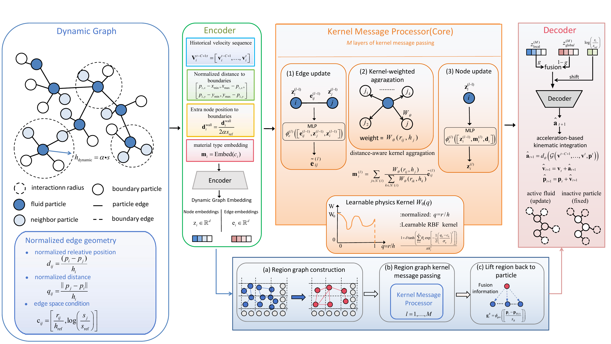
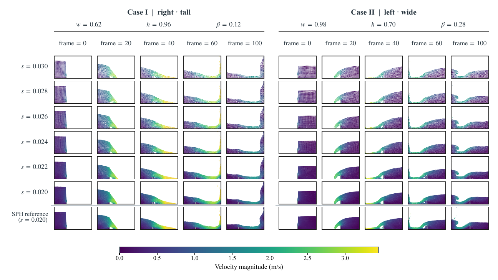
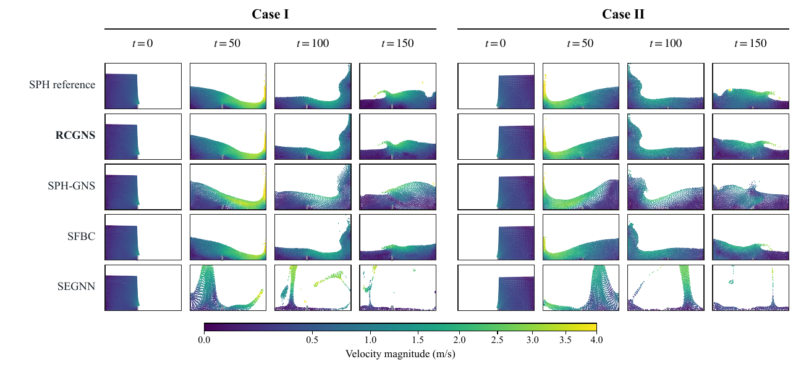
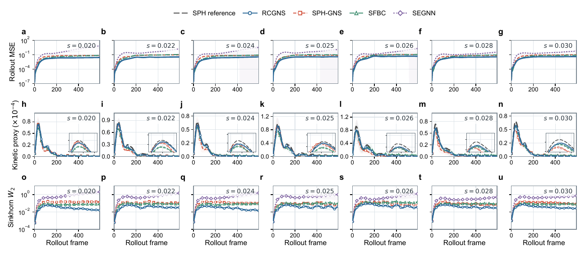
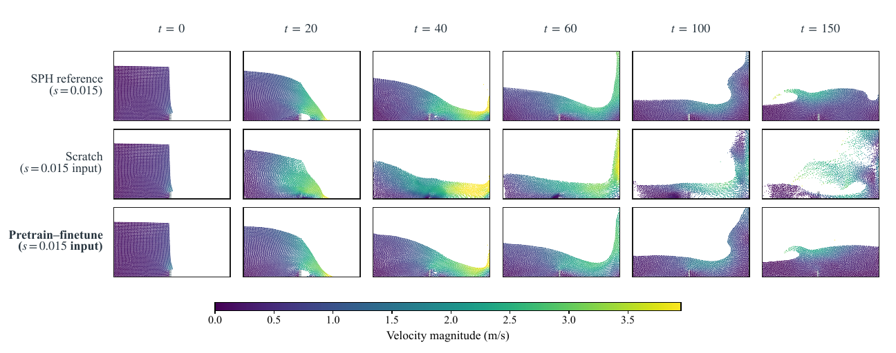

<div align="center">

# RCGNS

## Resolution-Conditioned Graph Neural Simulator

**Long-horizon free-surface particle simulation across spatial resolutions and boundary configurations**

Xuan Peng · Binbin Yin  
Department of Civil and Environmental Engineering, The Hong Kong Polytechnic University

[Overview](#overview) · [Method](#method) · [Results](#results) · [Videos](#velocity-rendered-rollouts) · [Getting started](#getting-started) · [Reproduction](#reproducing-the-experiments) · [中文](#中文概览)

[Model implementation](../../models/RCGNS/) · [Configuration](../../args/dam_break/RCGNS/args.json) · [Validated checkpoint](../../record/RCGNS/dam_break_kernel-5-600/20260913_170814/model_params/dam_break_kernel-5-600.pth) · [SPH tools](../../SPH/README.md) · [Paper figures](../../result_analyisis/1-paper-figure/) · [Efficiency benchmark](../../result_analyisis/tables/Computational%20efficiency/README.md)

</div>

<p align="center">
  <a href="./assets/animations/multiresolution_gallery.gif">
    
  </a>
</p>

<p align="center"><sub>
Four representative geometries × six particle spacings, rerun for rollout frames 0–150 with the current RCGNS checkpoint. Fixed point area exposes the true density change; the shared high-contrast velocity scale is identical across all 24 panels.
</sub></p>

<details>
<summary><b>Verified SPH reference comparison</b></summary>

<p align="center">
  <a href="./assets/animations/cross_resolution_rollout.gif">
    
  </a>
</p>

<p align="center"><sub>
Matched SPH-reference/RCGNS rollouts at six particle spacings from <i>s</i> = 0.030 to 0.020. Columns identify resolution, rows compare SPH and RCGNS, and one shared blue-to-red velocity scale is used throughout.
</sub></p>

</details>

> [!NOTE]
> This repository is a research implementation accompanying a manuscript in preparation. The main validated task is two-dimensional, gravity-dominated dam-break flow. Interfaces and experiment paths may still change.

## Overview

Particle GNNs commonly learn local dynamics at one fixed particle spacing. Changing the spacing changes relative distances, graph degree, and neighborhood statistics even when the underlying macroscopic flow is similar. A model can therefore confuse **a change in discretization** with **actual compression or particle motion**, and that ambiguity compounds during autoregressive rollout.

RCGNS addresses this problem with one model that combines:

1. a support radius tied to the current particle spacing;
2. normalized edge geometry with explicit resolution conditioning;
3. kernel-normalized local message aggregation;
4. a coarse region graph for longer-range information propagation; and
5. an SPH-inspired density/pressure correction during rollout.

The result is a particle simulator trained jointly over seven learning-domain spacings and evaluated under a common 594-step rollout protocol.

### Evidence at a glance

| Question | Result | Evaluation basis |
|---|---:|---|
| How many resolutions does one checkpoint cover? | **7 spacings** | $s\in\{0.020,0.022,0.024,0.025,0.026,0.028,0.030\}$ |
| How long is the standard rollout? | **594 predicted frames** | Five observed frames followed by fully autoregressive prediction |
| How broad is the standard test? | **97 paired trajectories** | Consistent SPH references and learned-model rollouts |
| Does RCGNS improve long-rollout distribution accuracy? | **Lowest rollout MSE, Sinkhorn-$W_2$, and MMD at all 7 spacings** | Same data split, inputs, integration, and correction protocol across models |
| Improvement over SPH-GNS at the resolution endpoints | **64.5% / 58.6% lower rollout MSE** | $s=0.020$ / $s=0.030$ |
| Measured saved-frame speedup over SPH | **14.94–20.14×** | CPU SPH versus RTX 5090 RCGNS inference including correction; $\Delta t=0.01\,\mathrm{s}$ |

The timing comparison is a measured end-to-end configuration, not a hardware-normalized algorithmic speedup. See the [benchmark protocol](../../result_analyisis/tables/Computational%20efficiency/README.md) for the exact scope.

## Why resolution conditioning is needed

| Challenge | What happens in a conventional fixed-spacing particle GNN? | RCGNS response |
|---|---|---|
| **Discretization–motion ambiguity** | Shorter edges may indicate finer sampling or true local compression. | Condition edge features and the decoder on particle spacing. |
| **Resolution-dependent graph degree** | A fixed physical radius creates many more neighbors as spacing decreases. | Use the dynamic support radius $h=3s$ to stabilize local graph scale and cost. |
| **Reduced physical reach** | Scaling $h$ with $s$ controls degree but shrinks the physical reach of local message passing. | Pool particles into a region graph, propagate coarse context, then lift it back to particles. |
| **Autoregressive drift** | Small one-step errors distort local density and accumulate over hundreds of frames. | Apply the same SPH-inspired density/pressure correction in the comparison protocol. |
| **Engineering-scale deployment** | The training domain cannot enumerate every geometrically similar physical scale. | Map gravity-dominated engineering cases to a common learning domain using Froude similarity. |

The central design choice is therefore not merely to append $s$ to a node vector. RCGNS injects resolution information where local interactions are formed and decoded, while the region branch supplies the larger-scale context lost by a resolution-dependent support radius.

## Method

<p align="center">
  
</p>

### Prediction problem

Given $C=5$ saved particle states, the model predicts normalized acceleration for every active fluid particle. Boundary particles participate in graph construction and message passing but are not acceleration targets. The predicted acceleration is denormalized and integrated to obtain the next velocity and position; the new state is then appended to the history for the next rollout step.

The trajectory tensor follows the repository convention `[batch, time, particle, 9]`:

| Channels | Meaning |
|---|---|
| `0:2` | position $(x,y)$ |
| `2:4` | velocity $(v_x,v_y)$ |
| `4:6` | acceleration $(a_x,a_y)$ |
| `6` | active-particle mask |
| `7` | particle/material type |
| `8` | particle spacing $s$ |

### One RCGNS transition

```text
5-frame particle history
          │
          ▼
dynamic local graph, h = 3s
          │
          ▼
resolution-conditioned edge encoding
          │
          ▼
10-layer local kernel message processor
          │
          ├──────────────┐
          ▼              ▼
   local features   grid-region pooling
                         │
                         ▼
                 4-layer region processor
                         │
                         ▼
                 geometry-aware lifting
          └──────────────┤
                         ▼
               local–region fusion
                         │
                         ▼
            resolution-conditioned decoder
                         │
                         ▼
              acceleration and integration
                         │
                         ▼
          SPH-inspired rollout correction
```

The default configuration uses a 128-dimensional hidden state, ten local processor layers, four region processor layers, $h/s=3$, and grid size $4s_{\mathrm{ref}}$. The kernel implementation is configurable; the current paper configuration is recorded in [`args.json`](../../args/dam_break/RCGNS/args.json), which should be treated as the source of truth.

### Engineering-to-learning-domain mapping

For geometrically similar, gravity-dominated flows, let $R=H_{\mathrm E}/H_{\mathrm L}$ be the engineering-to-learning length ratio. The mapping used by the project is

$$
\mathbf{x}_{\mathrm E}=R\mathbf{x}_{\mathrm L},\qquad
t_{\mathrm E}=\sqrt{R}\,t_{\mathrm L},\qquad
\mathbf{u}_{\mathrm E}=\sqrt{R}\,\mathbf{u}_{\mathrm L},\qquad
\mathbf{a}_{\mathrm E}=\mathbf{a}_{\mathrm L},\qquad
s_{\mathrm E}=Rs_{\mathrm L}.
$$

This maps engineering geometry and particle spacing into the model's learning domain, performs the rollout there, and restores position, time, and velocity afterward. It is a Froude-similarity construction and is not claimed to preserve every possible viscous or multiphase scale effect.

## Results

### Multi-resolution prediction

<p align="center">
  
</p>

Each row uses the trajectory and particle count belonging to that spacing; point size is fixed so the increasing sampling density remains visible. The final row is the independent SPH reference at $s=0.020$.

### Comparison with learned particle simulators

<p align="center">
  
</p>

SPH-GNS, SFBC, SEGNN, and RCGNS use the same dam-break split, state variables, five-frame history, acceleration target, integration rule, and inference-time SPH correction. SFBC and SEGNN also receive spacing information in their decoders. RCGNS differs by conditioning the **interaction representation itself** and adding the region branch. This distinction is important: the models have similar one-step errors, while their long-rollout stability differs substantially.

At $s=0.020$, rollout MSE is $1.973\times10^{-2}$ for RCGNS and $5.558\times10^{-2}$ for SPH-GNS. At $s=0.030$, the corresponding values are $3.160\times10^{-2}$ and $7.630\times10^{-2}$.

### Frame-wise metrics

<p align="center">
  
</p>

The metric curves expose behavior that a one-step score cannot: rollout error accumulation, bulk kinetic response, and particle-distribution drift. In the ablation study at $s=0.020$, removing the region branch increases rollout MSE from `0.0197` to `0.0774`, showing why local resolution conditioning alone is insufficient.

### Coarse-to-fine transfer

<p align="center">
  
</p>

The coarse-to-fine experiment first pretrains at $s=0.030$ and then fine-tunes at $s=0.015$. It is evaluated against a model trained from scratch at $s=0.015$. The purpose is to reduce high-resolution data and optimization cost—not to claim that the pretraining resolution alone is sufficient for fine-resolution accuracy.

## Velocity-rendered rollouts

All animations below were regenerated from saved RCGNS rollout tensors with one visual specification. Fluid color represents velocity magnitude, gray particles represent the internal solid boundary, and the displayed integer is the rollout frame. Every preview and click target references a GIF in `assets/animations/`.

<table>
  <tr>
    <td width="50%" align="center"><b>Arc</b></td>
    <td width="50%" align="center"><b>Pinched funnel</b></td>
  </tr>
  <tr>
    <td><a href="./assets/animations/arc_rollout.gif"></a></td>
    <td><a href="./assets/animations/pinched_funnel_rollout.gif"></a></td>
  </tr>
  <tr>
    <td align="center"><b>Wave wall</b></td>
    <td align="center"><b>Spiral wall</b></td>
  </tr>
  <tr>
    <td><a href="./assets/animations/wave_wall_rollout.gif"></a></td>
    <td><a href="./assets/animations/spiral_wall_rollout.gif"></a></td>
  </tr>
  <tr>
    <td colspan="2" align="center"><b>Poly-U</b></td>
  </tr>
  <tr>
    <td colspan="2" align="center"><a href="./assets/animations/poly_u_rollout.gif"></a></td>
  </tr>
</table>

Each boundary video contains 101 rendered frames sampled every three steps from a 301-frame prediction and is encoded at 20 fps. These cases are qualitative geometry stress tests: they demonstrate boundary-responsive behavior but do not replace paired SPH error measurements.

## Evaluation protocol

| Item | Protocol |
|---|---|
| Training resolutions | Joint training over seven spacings from `0.020` to `0.030` |
| Observation window | Five consecutive saved frames |
| Prediction target | Normalized acceleration of active fluid particles |
| Long rollout | Initial observation window only, followed by 594 autoregressive predictions |
| Standard test | 97 paired trajectories |
| Distribution metrics | MSE, Sinkhorn-$W_2$, and MMD |
| Mechanical diagnostics | Wet-front, center of mass, kinetic/potential energy, and kernel-density response |
| Baseline correction | The same SPH-inspired inference correction is enabled for all learned models |
| Timing interval | One learning-domain saved-frame interval, $\Delta t=0.01\,\mathrm{s}$ |

> [!IMPORTANT]
> The multi-resolution results evaluate jointly trained spacings inside the configured range. They should not be described as unrestricted out-of-range resolution extrapolation.

## Getting started

### Requirements

- Python and PyTorch with a CPU or CUDA backend;
- NumPy, Matplotlib, and tqdm;
- pygame only for the interactive trajectory viewer;
- additional dependencies only when running SFBC or SEGNN baselines.

```bash
python -m venv .venv

# Linux/macOS
source .venv/bin/activate

# Windows PowerShell
# .\.venv\Scripts\Activate.ps1

python -m pip install --upgrade pip
# Install PyTorch first with the wheel matching your CPU/CUDA environment,
# then install the remaining runtime packages:
python -m pip install numpy matplotlib tqdm pygame
```

Use the [official PyTorch installation selector](https://pytorch.org/get-started/locally/) to obtain the correct PyTorch command for the target machine.

### Configure paths

The RCGNS run is controlled by [`args/dam_break/RCGNS/args.json`](../../args/dam_break/RCGNS/args.json). At minimum, verify:

```json
{
  "data_path": "SPH/results/dam_break_dataset",
  "load_model_path": "record/RCGNS/dam_break_kernel-5-600/20260913_170814/model_params/dam_break_kernel-5-600.pth",
  "device": "cuda"
}
```

The dataset directory must contain `manifest.pt` and the referenced trajectory files. Use `"device": "cpu"` for a CPU-only check.

### Verify the model and normalization statistics

```bash
python -c "from load_model import load_model; m, _, _, c = load_model('dam_break', 'RCGNS'); print(type(m).__name__, c['space_filter'])"
```

Expected output begins with:

```text
RCGNS [0.02, 0.022, 0.024, 0.025, 0.026, 0.028, 0.03]
```

### Run the current rollout driver

In [`run_this.py`](../../run_this.py), set:

```python
model_choose = "RCGNS"
```

Keep `manager.test(...)` enabled and run:

```bash
python run_this.py
```

Set `is_show=False` in the test call for headless rollout generation. The checkpoint, dataset, rollout length, correction, and output locations are read from the RCGNS JSON configuration.

## Reproducing the experiments

| Task | Source of truth | Output |
|---|---|---|
| Generate or inspect SPH trajectories | [`SPH/README.md`](../../SPH/README.md) | `SPH/results/` |
| Configure the RCGNS experiment | [`args/dam_break/RCGNS/args.json`](../../args/dam_break/RCGNS/args.json) | Model and rollout settings |
| Load model and normalization data | [`load_model.py`](../../load_model.py) | Initialized RCGNS module |
| Inspect saved predictions | [`result/RCGNS/`](../../result/RCGNS/) | Rollout tensors and visualizations |
| Rebuild paper figures | [`result_analyisis/1-paper-figure/`](../../result_analyisis/1-paper-figure/) | PNG/PDF/SVG/TIFF figures |
| Benchmark inference | [`Computational efficiency/README.md`](../../result_analyisis/tables/Computational%20efficiency/README.md) | CSV, Markdown, LaTeX, plots, and provenance JSON |
| Rebuild homepage video | [`video_generation/README.md`](video_generation/README.md) | Verified MP4/GIF, preview, cached rollouts, and provenance manifest |

Final GPU efficiency command:

```bash
python "result_analyisis/tables/Computational efficiency/benchmark_rcgns_efficiency.py" --device cuda --require-cuda
```

The benchmark excludes model/data loading and table rendering. Its generated provenance records the checkpoint, sample selection, device, graph size, warm-up, repeats, and whether correction is enabled.

## Repository structure

```text
RCGNS/
├── models/
│   ├── RCGNS/                     # Proposed model and local-graph ablation family
│   ├── SFBC/                      # Continuous-convolution baseline
│   ├── SEGNN/                     # Equivariant baseline
│   └── APGNS/                     # Experimental area-pooling graph model
├── args/dam_break/                # Per-model experiment configurations and statistics
├── SPH/                           # Solver, dataset generation, and model–SPH pairing tools
├── model_params/                  # Checkpoints
├── result/                        # Saved rollouts
├── result_analyisis/              # Metrics, tables, figures, and efficiency benchmark
├── result_analyisis/github_homepage/
│   ├── assets/figures/            # GitHub figure assets
│   └── video_generation/          # Reproducible homepage videos and manifests
├── load_model.py                  # Unified model/config loader
└── run_this.py                    # Current training/evaluation driver
```

## Scope and limitations

- The current model is validated for **two-dimensional dam-break-type free-surface flows**.
- Multi-resolution experiments use a **uniform spacing per sample**. Dynamic, non-uniform adaptive particle refinement inside one domain is not part of the reported RCGNS results.
- Resolution results cover the configured training/test interval; unrestricted out-of-range extrapolation is not established.
- Custom internal-boundary rollouts are qualitative because paired SPH references are not available for every shape.
- Engineering-scale mapping assumes geometrically similar, gravity-dominated flows and does not enforce all viscous or multiphase similarity constraints.
- Reported speedup compares CPU SPH with GPU RCGNS plus correction and is therefore hardware- and implementation-dependent.

## 中文概览

固定粒子间距训练的粒子图网络容易把“分辨率变化造成的邻域变化”和“真实粒子运动”混在一起。较小的粒子相对距离既可能来自更细的离散，也可能来自流体局部压缩；这种歧义在长时序自回归预测中会不断累积。

RCGNS 的解决思路包含两层：局部层使用随粒子间距变化的支撑半径，并在边编码和解码阶段显式引入分辨率条件；区域层将粒子池化为较粗的区域图，补偿动态局部邻域物理感受野不足的问题。模型以五帧历史状态预测下一帧加速度，并在 rollout 阶段配合统一的 SPH 启发式密度/压力修正。

在 97 条配对标准测试轨迹和 594 步预测协议下，RCGNS 在七种测试间距上均取得最低的 rollout MSE、Sinkhorn-$W_2$ 和 MMD。相较 SPH-GNS，在 $s=0.020$ 和 $s=0.030$ 下的 rollout MSE 分别降低约 64.5% 和 58.6%。当前实现面向区间内多分辨率预测，并不等同于同一计算域内的动态自适应粒子加密。

## Citation

Citation metadata will be added when the manuscript is publicly released. Until then, please cite the repository URL and commit hash used for an experiment.

## Acknowledgements

RCGNS builds on graph-network simulators for Lagrangian dynamics and SPH methods for free-surface flow. When using the baseline implementations, please also cite the original GNS, SFBC, and SEGNN publications.
